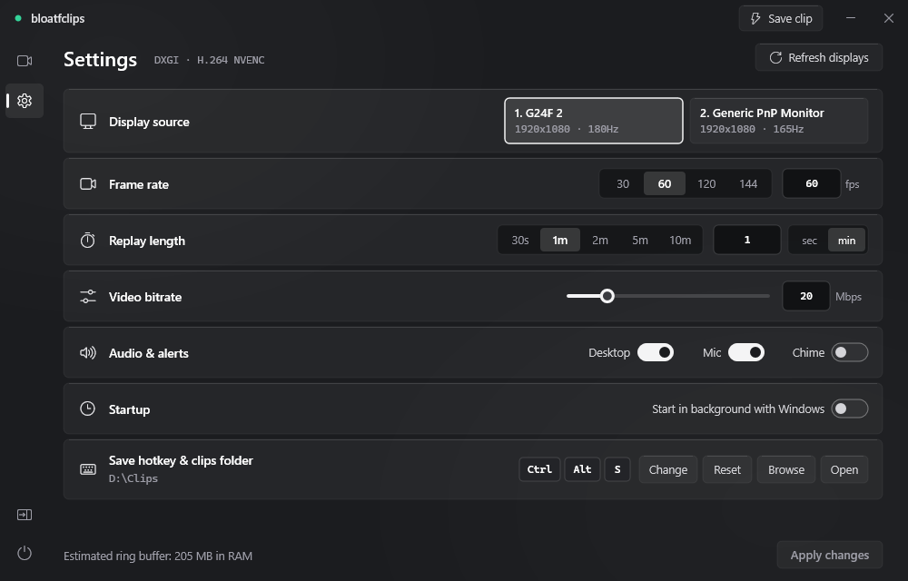
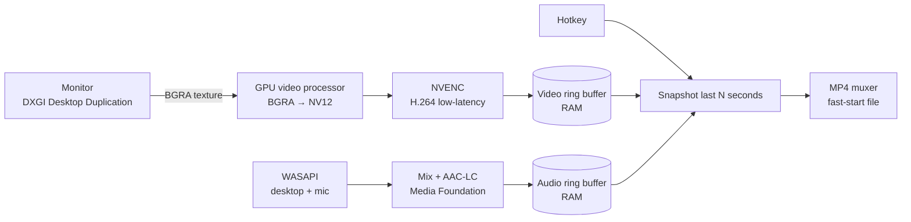

# bloatfclips

**Instant replay for Windows that stays out of your game's way.**

bloatfclips records your screen into memory in the background. When something worth keeping happens, press **Ctrl+Alt+S** and it saves the last minute as an MP4. Nothing is written to disk until you ask, nothing hooks into the game, and recording costs about 1% of frame time.



- [Features](#features)
- [Requirements](#requirements)
- [Install](#install)
- [Using bloatfclips](#using-bloatfclips)
- [Configuration](#configuration)
- [Performance](#performance)
- [How it works](#how-it-works)
- [Development](#development)
- [Troubleshooting](#troubleshooting)
- [Code signing policy](#code-signing-policy)
- [Privacy](#privacy)
- [License](#license)

## Features

- **Replay buffer in RAM.** Keeps the last 5 seconds to 60 minutes, set to 1 minute by default. Disk writes happen only when you save a clip.
- **One hotkey to save.** It works globally, even while a fullscreen game has focus. The clip is ready in a few milliseconds.
- **Hardware encoding.** Video is H.264 on the NVIDIA encoder (NVENC), so the CPU and 3D cores stay free for the game.
- **Desktop and microphone audio**, mixed into one AAC track. You can toggle either source, or mute the mic from the tray.
- **No overlays or injection.** bloatfclips never hooks DirectX `Present`, injects DLLs, or draws over your game.
- **Small native app.** One C++ executable with a Direct2D window and no Electron, WebView, or `ffmpeg.exe`. Closing the window frees all of its UI resources while recording continues from the tray.
- **Clips library.** Browse saved clips with thumbnails and durations, then play, reveal in Explorer, or delete them.

## Requirements

| | |
| --- | --- |
| OS | Windows 10 or 11, 64-bit |
| GPU | NVIDIA GPU with NVENC, driver **610 or newer** |

Nothing else needs to be installed: no .NET, no Visual C++ Redistributable.

bloatfclips records a whole monitor with DXGI Desktop Duplication, not a single window. Whatever is on that screen ends up in the clip.

## Install

1. Get `bloatfclips-setup-<version>.exe`. Download it from the repo's Releases page, or build it yourself (see [Building the installer](#building-the-installer)).
2. Run it. It installs just for your Windows account, so it doesn't ask for admin rights.
3. Choose whether bloatfclips should **start automatically when you sign in** (on by default) and whether you want a desktop shortcut.

bloatfclips starts recording right away. Its icon appears in the system tray and the window opens. Play something, press **Ctrl+Alt+S**, and the clip appears in `%USERPROFILE%\Videos\Clips` and on the **Clips** page.

> **"Windows protected your PC"?** The installer isn't code-signed yet, so SmartScreen warns about it. Click **More info**, then **Run anyway**.

**Updating:** run a newer setup over the existing install. Your settings are kept.

**Uninstalling:** go to **Settings → Apps → Installed apps → bloatfclips → Uninstall**. Uninstalling closes bloatfclips if it is running and removes the app, its settings, and the autostart entry. Your saved clips stay in your Videos folder.

## Using bloatfclips

### Window

The **Settings** page (screenshot above) changes the monitor, frame rate, replay length, bitrate, audio sources, save hotkey, and clips folder. Changes take effect when you click **Apply changes**. The footer shows how much RAM the replay buffer may use at most.

The **Clips** page lists up to 48 recent clips from the clips folder. Click a thumbnail to play it.

Closing the window hides bloatfclips to the tray and keeps recording. Launching `bloatfclips.exe` again reopens the existing window instead of starting a second copy.

### Tray icon

- **Left-click or double-click** opens the window.
- **Right-click** opens a menu with **Open Settings**, **Save Replay**, **Microphone** (mute toggle), **Open Clips Folder**, and **Exit**.

### Command-line flags

| Flag | Effect |
| --- | --- |
| `--tray`, `--minimized` | Start in the tray without opening the window |
| `--page=clips` / `--page=settings` | Open the window on a specific page |
| `--monitor=N` | Override `monitor_index` |
| `--fps=N` | Override `fps` |
| `--bitrate=N` | Override `bitrate_mbps` |
| `--seconds=N` | Override `replay_seconds` |
| `--output-dir=PATH` | Override `output_dir` |
| `--hotkey=COMBO` | Override `hotkey_save`, for example `--hotkey=Ctrl+Shift+F9` |
| `--no-desktop-audio` | Do not record desktop sound |
| `--no-mic-audio` | Do not record the microphone |
| `--no-chime` | Do not beep after a save |
| `--fail-fast` | Exit with code `2` if capture cannot start |
| `--ready-event=NAME` | Signal a named Win32 event once capture is running (for scripts and benchmarks) |

The installer's autostart option runs `bloatfclips.exe --tray` at sign-in.

## Configuration

Settings are stored in `clipper.ini` next to `bloatfclips.exe`. With the installer, that's `%LOCALAPPDATA%\Programs\bloatfclips\clipper.ini`. The file is created on first launch and rewritten when you click **Apply changes** in the window.

| Key | Default | Allowed values | Notes |
| --- | --- | --- | --- |
| `monitor_index` | `0` | `0..N-1` | Monitor to record. NVIDIA-attached outputs are listed first. |
| `fps` | `60` | `15..240` | Capture and encode frame rate |
| `bitrate_mbps` | `20` | `2..80` | Average bitrate (VBR, peak 1.35×) |
| `replay_seconds` | `60` | `5..3600` | Length of the replay buffer |
| `record_desktop_audio` | `true` | `true` / `false` | Record system sound |
| `record_mic_audio` | `true` | `true` / `false` | Record the default microphone |
| `hotkey_save` | `Ctrl+Alt+S` | Modifiers + key | For example `Ctrl+Shift+F9`, `Alt+Numpad0`, or `Ctrl+Backtick` |
| `output_dir` | `%USERPROFILE%\Videos\Clips` | Folder path | Environment variables are expanded. The folder is created on first save. |
| `save_chime` | `true` | `true` / `false` | Beep when a clip is saved |

`bitrate_mbps × replay_seconds` is capped at 48,000. That limits the buffer to about 8 GB, and longer replay lengths are clamped at startup. For example, 80 Mbps allows up to 10 minutes and 20 Mbps up to 40 minutes.

**How much RAM will it use?** Roughly `bitrate × replay length`, but only for what is actually recorded. A mostly static desktop uses far less than the maximum the Settings footer shows. A fast-moving game gets close to the average bitrate.

## Performance

These numbers were measured on Windows 11 with an Intel Core i5-14500HX, an RTX 4050 Laptop GPU (driver 621.24), and two 1080p displays at default settings (1080p60, 20 Mbps, 60 s).

| What | Result |
| --- | --- |
| RAM in the tray, idle desktop, steady state | **~110 MB** |
| Extra frame time in a GPU-bound 3D test (~195 FPS) | **+0.055 ms p50 (~1.1%)** |
| bloatfclips CPU usage while recording | **~0.2%** |
| Disk writes while recording | **0 B** |
| Capture + encode submit per frame | 385 µs median, 521 µs p95 |
| Time to save a 3-second clip | ~3 ms |

To reproduce them, see [Development](#development). The frame-time number comes from five alternating on/off rounds of `clipper_bench.exe --gpu-load-bench`.

## How it works



- **Capture.** The monitor image stays on the GPU. A fixed-function video processor converts it to NV12, then NVENC encodes it with no lookahead, no B-frames, and a keyframe every second. No CUDA or 3D shader work runs.
- **Buffering.** Encoded packets go into a ring buffer in RAM. Packets older than the replay length are dropped one keyframe interval at a time, and their memory is returned to Windows, so RAM follows the real bitrate.
- **Saving.** A save copies the window out of the ring without pausing capture, writes a fast-start MP4 to a temporary file, and renames it into place.
- **UI.** The window is Direct2D and DirectWrite with no child controls. When closed, its window, GPU surfaces, and timers are destroyed, so a hidden bloatfclips has no UI cost.

For data shapes, the state machine, and threading, see [`docs/designs/clipper_architecture.md`](docs/designs/clipper_architecture.md).

## Development

### Building from source

You need Visual Studio Build Tools 2022 (MSVC), the Windows SDK 10.0.26100 or compatible, CMake 3.20+, and Ninja. Run this from a **Developer Command Prompt**, or call `vcvars64.bat` first:

```cmd
"C:\Program Files (x86)\Microsoft Visual Studio\2022\BuildTools\VC\Auxiliary\Build\vcvars64.bat"
cmake -B build -G Ninja -DCMAKE_BUILD_TYPE=Release
cmake --build build
.\build\bloatfclips.exe
```

The runtime is linked statically (`/MT`), so `bloatfclips.exe` runs on a clean Windows install without the Visual C++ Redistributable.

### Building the installer

The installer is made with [Inno Setup 6](https://jrsoftware.org/isinfo.php). Install it once, then build:

```powershell
winget install JRSoftware.InnoSetup
powershell -ExecutionPolicy Bypass -File tools\build_installer.ps1
```

The script builds a Release exe in `build-release\` and writes `dist\bloatfclips-setup-<version>.exe`. The installer itself is defined in [`installer/bloatfclips.iss`](installer/bloatfclips.iss).

The version number comes from [`src/app.rc`](src/app.rc), so bump `BFC_VERSION_NUM` and `BFC_VERSION_STR` there before a release.

### Releases (GitHub Actions)

[`.github/workflows/build.yml`](.github/workflows/build.yml) builds the exe and the installer on GitHub's Windows runners for every push to `master` and every pull request. Download the installer from the run's **Artifacts**.

To publish a release, bump the version in `src/app.rc`, merge it, then push a matching tag:

```powershell
git tag v0.2.0
git push origin v0.2.0
```

The workflow fails if the tag doesn't match the version in `src/app.rc`. Otherwise it creates the GitHub Release and attaches `bloatfclips-setup-0.2.0.exe`. The runners have no NVIDIA GPU, so the capture and encoder tests only run locally (`clipper_tests.exe`).

Release builds can be code-signed through SignPath Foundation. For the one-time setup, see [`docs/signing.md`](docs/signing.md). The app icon is generated by [`tools/make_icon.ps1`](tools/make_icon.ps1) into `assets/bloatfclips.ico`.

### Project layout

```
src/
  main.cpp              app entry, tray icon, hotkey, single-instance handling
  recorder_engine.*     owns the pipelines and ring buffers, handles saves
  video_pipeline.*      DXGI capture → video processor → NVENC
  audio_engine.*        WASAPI loopback + mic, mixing, AAC encode
  ring_buffer.*         packet ring buffer with time-based retention
  mp4_muxer.*           MP4 (ftyp/moov/mdat) writer
  settings_window.*     Direct2D desktop UI (Clips + Settings)
  clip_library.*        clip folder scan, thumbnails, durations
  config.*              clipper.ini + CLI parsing and validation
tests/unit_tests.cpp    unit and end-to-end tests
tools/clipper_bench.cpp live self-test and GPU load benchmark
tools/build_installer.ps1  Release build + installer
installer/bloatfclips.iss  Inno Setup installer definition
assets/bloatfclips.ico  app icon (generated by tools/make_icon.ps1)
third_party/nvcodec/    NVENC API header (Video Codec SDK 13.1)
```

### Tests and benchmarks

The build produces three executables: `bloatfclips.exe`, `clipper_tests.exe`, and `clipper_bench.exe`.

```powershell
# Unit + encode/decode round-trip tests (should end with "Total failures: 0")
.\build\clipper_tests.exe

# Record 3 seconds of the real desktop, save it, and decode it back
.\build\clipper_bench.exe --self-test-clip 3 --out .\build\test_out\live_replay.mp4

# Frame-time impact on a 3D load, 5 alternating rounds with bloatfclips off/on
.\build\clipper_bench.exe --gpu-load-bench 3 --runs 5
```

Close other running copies of bloatfclips, games, and GPU-heavy apps before benchmarking, or the numbers will be noisy.

## Troubleshooting

| Problem | Fix |
| --- | --- |
| Capture fails with `0x80070005` (`E_ACCESSDENIED`) | Desktop Duplication does not work from sandboxed or low-integrity processes. Run bloatfclips from a normal desktop session. |
| bloatfclips exits immediately or capture never starts | Check that you have an NVIDIA GPU with driver 610 or newer. Run with `--fail-fast` to get exit code `2` on failure. |
| Hotkey does nothing | Another app may already own the combination. Pick a different one under **Settings → Save hotkey**. |
| Saved clip is shorter than the replay length | The buffer only holds what was recorded since bloatfclips started. Applying new capture settings (monitor, frame rate, bitrate, length, audio) restarts recording and empties it. |
| No sound in clips, or bloatfclips won't start on Windows "N" editions | Install the **Media Feature Pack** from Settings → Apps → Optional features. bloatfclips uses Media Foundation for audio encoding. |
| Wrong monitor recorded | Pick it under **Settings → Display source**, or set `monitor_index`. Click **Refresh displays** after plugging in a monitor. |

## Code signing policy

Free code signing provided by [SignPath.io](https://about.signpath.io), certificate by [SignPath Foundation](https://signpath.org).

- Committers and reviewers: [sacredcodr](https://github.com/sacredcodr)
- Approvers: [sacredcodr](https://github.com/sacredcodr)

Signed binaries are built only from this repository's source by the [GitHub Actions workflow](.github/workflows/build.yml), on GitHub-hosted runners. Every release is approved by hand before it is signed. Changes from contributors outside the team are reviewed before they are merged.

## Privacy

This program will not transfer any information to other networked systems unless specifically requested by the user or the person installing or operating it.

bloatfclips has no network code. Recordings stay in memory until you save a clip, and saved clips go only to the folder you choose.

## License

bloatfclips is released under the [MIT License](LICENSE).

`third_party/nvcodec/nvEncodeAPI.h` is © NVIDIA Corporation and distributed under the MIT license, as stated in the file header.
